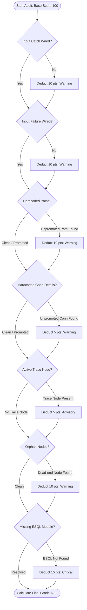

# IBM App Connect Enterprise (ACE) Message Flow AI Documenter & Architectural Agent
## Comprehensive Technical Documentation: `ace_flow_agent.py`

---

## 1. Executive Summary & Purpose

**`ace_flow_agent.py`** is an enterprise-grade, zero-dependency Python tool and automated architectural agent designed for **IBM App Connect Enterprise (ACE v11 / v12)** and **IBM Integration Bus (IIB v9 / v10)**.

In enterprise integration environments, message flows frequently suffer from:
- **Documentation Drift**: Specifications diverge rapidly from actual `.msgflow` implementations.
- **Architectural Anti-Patterns**: Unhandled error terminals (`catch`/`failure`), hardcoded paths, active trace nodes in production, and orphaned subcomponents.
- **Opacity in Audits**: Lack of clear, shareable visual diagrams depicting runtime sequence, external protocols, and ESQL transformation logic.

`ace_flow_agent.py` solves these challenges by statically parsing `.msgflow` and `.subflow` XML definitions, indexing workspace `.esql` routines, checking enterprise design best practices (Health Score 0–100), generating interactive Mermaid.js diagrams, and compiling complete, audit-ready Markdown or JSON documentation.

---

## 2. Key Capabilities & Features

| Capability | Details |
| :--- | :--- |
| **Universal Node Taxonomy** | Categorizes any built-in or user-defined node (HTTP, MQ, File, Kafka, TCP/IP, Database, SOAP, Compute, JavaCompute, Mapping, Trace, TryCatch, etc.) without hardcoding. |
| **Protocol & Endpoint Discovery** | Automatically extracts URLs, Queue Managers, Queues, Topics, Host/Port combinations, and Directories directly from node properties and promoted configurations. |
| **Workspace-Wide ESQL Resolution** | Traverses folders and libraries to resolve `esql://routine/...` expressions, extracting the exact ESQL Compute/Database modules and procedures associated with each node. |
| **High-Fidelity Mermaid Diagrams** | Generates two types of diagrams: (1) **Topology Flowchart** (color-coded by node classification with external service badges) and (2) **Topological Execution Sequence Diagram** (depicting message flow order, transformations, and error handling branches). |
| **Static Flow Health & Rules Engine** | Performs automated static audits, evaluating error handling completeness, hardcoded configuration portability, production trace alerts, dead-end nodes, and missing code modules. |
| **Promoted Property / UDP Tracking** | Maps User Defined Properties (UDPs) from `attributeLinks` and `eStructuralFeatures` to the specific flow nodes they override. |
| **Workspace Catalog Generator** | In batch mode (`--all` or folder input), indexes all flows across applications/libraries, generating a master inventory, subflow call hierarchy, and shared ESQL registry. |
| **Optional AI Architectural Review** | Leverages Google Gemini (`google-genai` / `google-generativeai`) to provide expert architectural critiques on transactions, memory, and containerization. |
| **Zero Core Dependencies** | Built entirely on the Python Standard Library (`xml.etree.ElementTree`, `re`, `argparse`, `pathlib`, `collections`, `json`). |

---

## 3. Architecture & Class Design

```
ace_flow_agent.py
│
├── NodeCategory              # Semantic constants for classifying nodes
├── ACENode                   # Data model for individual flow nodes
├── ACEConnection             # Data model for node wires / terminal linkages
├── PromotedProperty          # Model for UDPs and promoted attributes
│
├── ESQLWorkspaceResolver     # Workspace scanner and regex indexer for .esql files
├── ACEFlowParser             # XML parser for .msgflow and .subflow structures
├── ACEFlowGraph              # Directed Acyclic Graph (DAG) & topological sorter
│
├── GenericMermaidGenerator   # Mermaid flowchart & sequence diagram renderer
├── GenericFlowAuditor        # Rules engine & health scoring (0-100, Grades A-F)
│
├── ACEFlowAgent              # Single-flow orchestration pipeline
├── ACEWorkspaceCatalogAgent  # Multi-flow batch processor & Master Catalog compiler
└── main()                    # CLI argument parsing and execution dispatch
```

### Class Roles & Responsibilities

### `NodeCategory`
Defines operational categories:
- `INPUT`: Inbound message sources (HTTP Input, MQ Input, Kafka Consumer, File Input).
- `OUTPUT`: Outbound replies and destinations (HTTP Reply, MQ Output, Kafka Producer).
- `REQUEST`: Synchronous client calls (HTTP Request, SOAP Request).
- `COMPUTE`: Transformations and calculations (Compute, JavaCompute, Mapping, XSLT).
- `ROUTING`: Decisions, branching, filtering (Route, Filter, Label).
- `DIAGNOSTIC`: Logging and tracing (Trace).
- `ERROR`: Exception interception and rethrowing (TryCatch, Throw).
- `SUBFLOW`: Embedded modular subflows.
- `GENERIC`: Other processing nodes.

### `ACENode`
Represents an individual node parsed from XML.
- Strips vendor prefixes: `ComIbmWSInput.msgnode:FCMComposite_1` &rarr; `WSInput`.
- Categorizes node behavior using keyword heuristics in `_classify_category()`.
- Extracts protocols and target resources via `get_protocol_endpoint_info()`.

### `ACEConnection`
Represents a connection wire between two node terminals.
- Strips composite prefixes: `FCMComposite_1_1.out` &rarr; `out`.
- Identifies error terminals (`catch`, `failure`, `timeout`, `nomatch`) via `_is_error_terminal()` to style error paths distinctly in diagrams.

### `ESQLWorkspaceResolver`
Scans the workspace directory tree for all `.esql` files and indexes:
- **Broker Schemas**: `BROKER SCHEMA <schema>`
- **Modules**: `CREATE COMPUTE/DATABASE/FILTER MODULE <name> ... END MODULE;`
- **Functions & Procedures**: Standalone logic and helper routines.
- Resolves expressions like `esql://routine/com.ibm.echo#PrepareResponse.Main` to the exact module definition and source file.

### `ACEFlowParser`
Parses `.msgflow` and `.subflow` XML files:
1. Strips all XML namespaces (`xmlns:ecore`, `xmlns:eflow`, etc.) for version-independent parsing.
2. Extracts promoted properties and UDP overrides from `eStructuralFeatures` and `attributeLinks`.
3. Instantiates `ACENode` objects for all `<nodes>` elements.
4. Instantiates `ACEConnection` objects for all `<connections>` elements.
5. Invokes `ESQLWorkspaceResolver` to attach ESQL source code to Compute nodes.

### `ACEFlowGraph`
Constructs a Directed Acyclic Graph (DAG) from parsed nodes and connections:
- Identifies root nodes (in-degree = 0 or `Input` category).
- Identifies terminal nodes (out-degree = 0 or `Output`/`Reply` category).
- Implements Kahn's Algorithm (BFS) in `topological_order()` to arrange nodes in logical runtime execution sequence.

### `GenericMermaidGenerator`
Generates diagram code for documentation:
- **Flowchart**: Left-to-right (`flowchart LR`) topology with custom Mermaid node shapes (stadium for input, subroutine for output/subflow, hexagon for error handling) and external service blocks.
- **Sequence Diagram**: `sequenceDiagram` showing the chronological flow of messages, ESQL module executions, and enclosed error branches (`rect rgb(254, 242, 242)`).

### `GenericFlowAuditor`
Evaluates static quality rules and calculates a Health Score (0–100) and letter grade:
- **A (90–100%)**: Production Ready.
- **B (80–89%)**: Good / Minor improvements suggested.
- **C (70–79%)**: Needs Architectural Review.
- **D (50–69%)**: High Risk.
- **F (<50%)**: Critical Deficiencies.

### `ACEFlowAgent`
Coordinates the end-to-end documentation of a single `.msgflow` or `.subflow`:
1. Executes `ACEFlowParser.parse()`.
2. Builds `ACEFlowGraph`.
3. Runs `GenericFlowAuditor.audit()`.
4. Generates Mermaid diagrams.
5. Optionally invokes Gemini LLM via `_run_ai_critique()`.
6. Compiles and writes the Markdown file.

### `ACEWorkspaceCatalogAgent`
Scans a repository for all flow files, invokes `ACEFlowAgent` on each, and writes a master inventory (`ACE_Flow_Catalog.md`) containing:
- Executive inventory table with links to individual docs.
- Workspace subflow invocation map.
- Catalog of all indexed shared ESQL modules.

---

## 4. CLI Usage & Command Reference

The agent is invoked via Python with command-line arguments:

```bash
python ace_flow_agent.py [TARGET] [OPTIONS]
```

### Argument Reference

| Argument | Flag | Type | Description |
| :--- | :--- | :--- | :--- |
| `target` | Positional | `path` | Path to a `.msgflow`/`.subflow` file OR a directory (default: `.`) |
| `--all` | `-a` | Flag | Recursively discover and document all flows in directory |
| `--output` | `-o` | `path` | Output markdown file (single flow) or output directory (batch) |
| `--diagram-only` | | Flag | Output only the Mermaid diagram code to standard output |
| `--ai` | | Flag | Enable Gemini AI architectural critique (requires `GEMINI_API_KEY`) |
| `--json` | | Flag | Output structured JSON metadata to standard output |

### Common Command Examples

#### 1. Document a Single Message Flow
```bash
python ace_flow_agent.py ace-sample-app/SampleFlow.msgflow
```
*Generates `SampleFlow_documentation.md` in the current directory.*

#### 2. Specify Output Path
```bash
python ace_flow_agent.py ace-sample-app/SampleFlow.msgflow -o ./docs/SampleFlow_Spec.md
```

#### 3. Batch Scan and Catalog an Entire Workspace
```bash
python ace_flow_agent.py . --all -o ./docs
```
*Discovers all flows in the workspace, writes individual documentation files into `./docs`, and creates `./docs/ACE_Flow_Catalog.md`.*

#### 4. Extract Mermaid Diagrams Directly to Terminal
```bash
python ace_flow_agent.py ace-sample-app/SampleFlow.msgflow --diagram-only
```

#### 5. Output Machine-Readable JSON for CI/CD Gates
```bash
python ace_flow_agent.py ace-sample-app/SampleFlow.msgflow --json
```

#### 6. Run with Gemini AI Architectural Review
```bash
# Set your API key
export GEMINI_API_KEY="AIzaSy..."       # Linux/macOS
$env:GEMINI_API_KEY="AIzaSy..."        # Windows PowerShell

python ace_flow_agent.py ace-sample-app/SampleFlow.msgflow --ai
```

---

## 5. Static Audit Rules & Health Scoring Guide

The audit engine enforces enterprise integration patterns and flags risky antipatterns.



### Detailed Rules Matrix

| Rule Name | Severity | Penalty | Problem Description | Recommended Remediation |
| :--- | :--- | :--- | :--- | :--- |
| **Unwired Input Catch Terminal** | `WARNING` | **-10 pts** | Downstream exceptions trigger default broker rollbacks and potential message loops if the `catch` terminal is unwired. | Connect the `catch` terminal of the Input node to an error handling subflow or logging node. |
| **Unwired Input Failure Terminal** | `WARNING` | **-10 pts** | Malformed input payloads or parsing errors fail immediately at the input node without structured alerting. | Connect the `failure` terminal to an error handler or reply node. |
| **Hardcoded File Path** | `WARNING` | **-10 pts** | Hardcoded filesystem paths (e.g., `C:\data` or `/var/log`) prevent environment-agnostic deployment. | Promote the path property to a User Defined Property (UDP) or configure via BAR overrides. |
| **Hardcoded Connection Details** | `WARNING` | **-5 pts** | Static hostnames/ports prevent dynamic environment promotion between DEV, QA, and PROD. | Promote `connectionDetails` or attach a dynamic Policy (`.policyxml`). |
| **Active Production Trace Node** | `ADVISORY` | **-5 pts** | `Trace` nodes writing to disk introduce synchronous file I/O overhead in production runtimes. | Remove the Trace node or disable it prior to production BAR compilation. |
| **Orphan / Disconnected Node** | `WARNING` | **-10 pts** | A node exists on the canvas without incoming or outgoing connections. | Delete the unused node to reduce clutter and runtime overhead. |
| **Missing ESQL Module** | `CRITICAL` | **-15 pts** | A Compute node references an ESQL routine not present in any workspace `.esql` file. The BAR will fail to deploy. | Verify the module name and ensure the companion `.esql` file is located in the application or referenced library. |

---

## 6. Generated Output Artifacts

### 1. Individual Flow Documentation (`<FlowName>_documentation.md`)
Includes:
- **Executive Summary**: Node count, connection count, health score, and inbound/outbound protocol endpoints.
- **Topology Flowchart**: Interactive Mermaid diagram with styled nodes, terminals, and external dependencies.
- **Execution Sequence Diagram**: Sequence diagram with chronological steps and exception handling blocks.
- **Node Specifications Table**: Comprehensive matrix of node labels, types, locations, UDP mappings, and operational properties.
- **Connection & Routing Matrix**: Source/target node and terminal mapping, classified as Standard or Error paths.
- **Promoted Properties (UDPs)**: Table of externalized parameters and their default values.
- **Associated ESQL Code**: Complete syntax-highlighted SQL blocks of all referenced compute modules.
- **Architectural & Reliability Audit Findings**: List of passed checks and remediation recommendations.
- **AI Architectural Critique (Optional)**: In-depth assessment from Google Gemini.

### 2. Workspace Master Catalog (`ACE_Flow_Catalog.md`)
Includes:
- **Executive Message Flow Inventory**: Master table linking to every documented flow with its inbound interface, node counts, and health grades.
- **Workspace Dependency Map**: Mermaid flowchart showing inter-flow and subflow invocation hierarchies across the repository.
- **Discovered Shared ESQL Modules**: Workspace-wide catalog of all indexed ESQL modules, their schemas, and source files.

---

## 7. CI/CD Integration & Automated Quality Gates

`ace_flow_agent.py` can be integrated into build pipelines to enforce architectural compliance before generating BAR files.

### GitHub Actions Pipeline Example (`.github/workflows/ace_audit.yml`)

```yaml
name: ACE Flow Architecture Quality Gate

on:
  pull_request:
    paths:
      - '**/*.msgflow'
      - '**/*.subflow'
      - '**/*.esql'

jobs:
  flow-audit:
    runs-on: ubuntu-latest
    steps:
      - name: Checkout Code
        uses: actions/checkout@v4

      - name: Set up Python
        uses: actions/setup-python@v5
        with:
          python-version: '3.11'

      - name: Audit Workspace Flows
        run: |
          python ace_flow_agent.py . --all --json > audit_results.json

      - name: Enforce Minimum Health Score (Gate >= 80, Grade B)
        run: |
          python -c "
          import json, sys
          with open('audit_results.json') as f:
              data = json.load(f)
          failed = [f\"{f['flow_name']}: {f['score']}/100 ({f['grade']})\" for f in data.get('documented', []) if f['score'] < 80]
          if failed:
              print('[ERROR] Quality Gate Failed! The following flows do not meet architectural standards:')
              for item in failed:
                  print('  - ' + item)
              sys.exit(1)
          print('[SUCCESS] All message flows passed architectural health audit.')
          "

      - name: Publish Documentation Artifacts
        if: always()
        uses: actions/upload-artifact@v4
        with:
          name: ace-documentation
          path: |
            *_documentation.md
            ACE_Flow_Catalog.md
```

### Git Pre-Commit Hook Example (`.git/hooks/pre-commit`)

```bash
#!/bin/sh
# Pre-commit hook to prevent committing flows with critical audit defects
echo "Running ACE Flow Architectural Audit..."

python ace_flow_agent.py . --all --json > .temp_audit.json

CRITICALS=$(python -c "
import json
with open('.temp_audit.json') as f:
    data = json.load(f)
crit = [f['flow_name'] for f in data.get('documented', []) if f['score'] < 70]
print(len(crit))
")

rm .temp_audit.json

if [ "$CRITICALS" -gt 0 ]; then
    echo "[REJECTED] One or more message flows scored below 70 (Grade C or lower). Fix audit findings before committing."
    exit 1
fi

echo "[PASSED] Flow health validation successful."
exit 0
```

---

## 8. Real-World Case Study: `SampleFlow.msgflow`

Below is an overview of how `ace_flow_agent.py` processes the sample application in this workspace:

- **Source File**: `ace-sample-app/SampleFlow.msgflow`
- **Companion ESQL**: `ace-sample-app/SampleFlow_Compute.esql`
- **Parsed Nodes**:
  1. `HTTPInput` (`WSInput`): Inbound HTTP listener on endpoint `/`.
  2. `Compute` (`Compute`): Executes `SampleFlow_Compute.Main`.
  3. `Mapping` (`MSLMapping`): Message map transform.
  4. `HTTP Reply` (`WSReply`): Outbound HTTP response.
- **Audit Findings**:
  - `[WARNING]` Input node `HTTPInput` has unwired `catch` and `failure` terminals (-20 pts).
  - Health Score: **80/100 (Grade B)**.
- **Generated Documentation**: [`SampleFlow_documentation.md`](file:///c:/Users/Personal/Downloads/ace-sample-main/SampleFlow_documentation.md)
- **Master Catalog Entry**: [`ACE_Flow_Catalog.md`](file:///c:/Users/Personal/Downloads/ace-sample-main/ACE_Flow_Catalog.md)

---

## 9. Extending and Customizing

### Adding a New Integration Protocol
To detect custom adapters or cloud nodes, extend `ACENode.get_protocol_endpoint_info()` in `ace_flow_agent.py`:

```python
# Custom Protocol Detection
if "smtpServer" in self.properties:
    return {"type": "Email", "label": "SMTP Server", "value": self.properties["smtpServer"]}

if "sftpHost" in self.properties:
    return {"type": "SFTP", "label": "SFTP Host", "value": self.properties["sftpHost"]}
```

### Adjusting Audit Score Penalties
All audit deductions and thresholds can be configured in `GenericFlowAuditor.audit()`. Modify the point values associated with each condition to match your organization's architectural policies.

---

## 10. Summary & File References

- **Script**: [`ace_flow_agent.py`](file:///c:/Users/Personal/Downloads/ace-sample-main/ace_flow_agent.py)
- **Flow Documentation**: [`SampleFlow_documentation.md`](file:///c:/Users/Personal/Downloads/ace-sample-main/SampleFlow_documentation.md)
- **Workspace Catalog**: [`ACE_Flow_Catalog.md`](file:///c:/Users/Personal/Downloads/ace-sample-main/ACE_Flow_Catalog.md)

