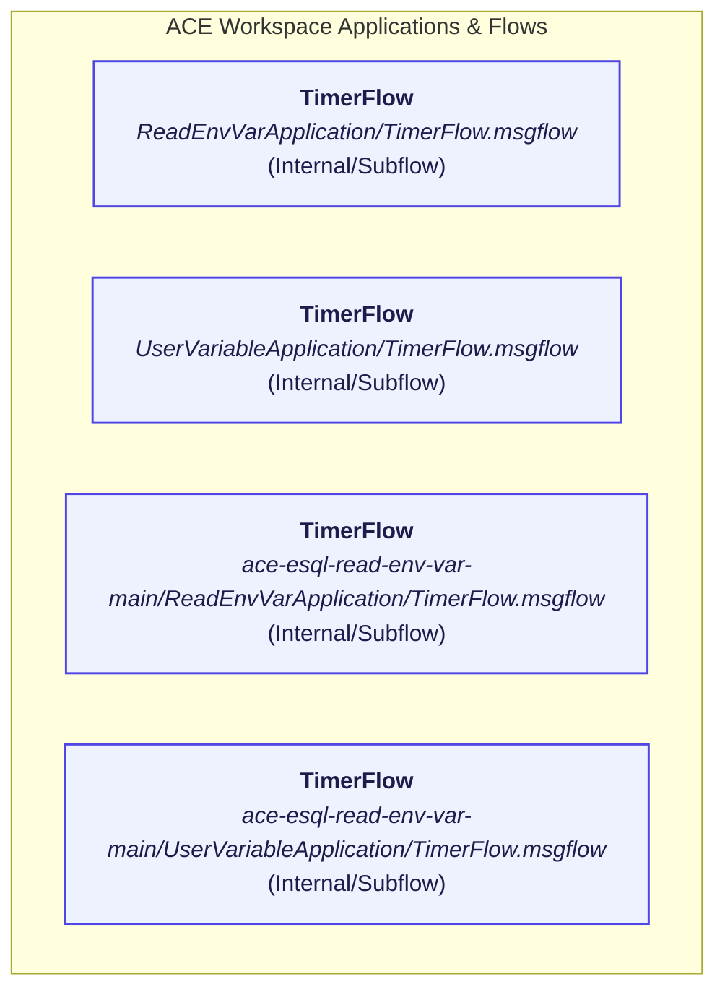

# IBM App Connect Enterprise (ACE) Workspace Flow Catalog

> **Workspace Path:** `C:\Users\Personal\Downloads\ace-esql-read-env-var-main`  
> **Total Flows & Subflows:** 4  
> **Total ESQL Files Discovered:** 4  

## 1. Executive Message Flow Inventory

| Flow Name | Type | Relative Path | Inbound Interface | Nodes | Wires | Health Grade | Documentation |
| :--- | :--- | :--- | :--- | :--- | :--- | :--- | :--- |
| **TimerFlow** | `Message Flow` | `ReadEnvVarApplication\TimerFlow.msgflow` | `Internal/Subflow` | 2 | 1 | **A** (100%) | [TimerFlow_documentation.md](./TimerFlow_documentation.md) |
| **TimerFlow** | `Message Flow` | `UserVariableApplication\TimerFlow.msgflow` | `Internal/Subflow` | 2 | 1 | **A** (100%) | [UserVariableApplication_TimerFlow_documentation.md](./UserVariableApplication_TimerFlow_documentation.md) |
| **TimerFlow** | `Message Flow` | `ace-esql-read-env-var-main\ReadEnvVarApplication\TimerFlow.msgflow` | `Internal/Subflow` | 2 | 1 | **A** (100%) | [ReadEnvVarApplication_TimerFlow_documentation.md](./ReadEnvVarApplication_TimerFlow_documentation.md) |
| **TimerFlow** | `Message Flow` | `ace-esql-read-env-var-main\UserVariableApplication\TimerFlow.msgflow` | `Internal/Subflow` | 2 | 1 | **A** (100%) | [ace_esql_read_env_var_main_UserVariableApplication_TimerFlow_documentation.md](./ace_esql_read_env_var_main_UserVariableApplication_TimerFlow_documentation.md) |

## 2. Workspace Integration & Dependency Map

## 3. Discovered Shared ESQL Modules

Total **1** unique ESQL modules indexed across the workspace:

| Module Name | Type | Schema | Source ESQL File |
| :--- | :--- | :--- | :--- |
| **TimerFlow_Compute** | `COMPUTE` | *(default)* | `TimerFlow_Compute.esql` |

---
*Generated automatically by ACE Flow Architectural Agent.*