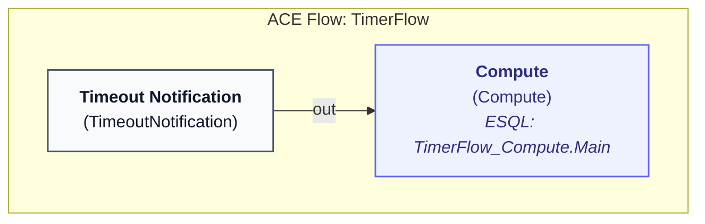
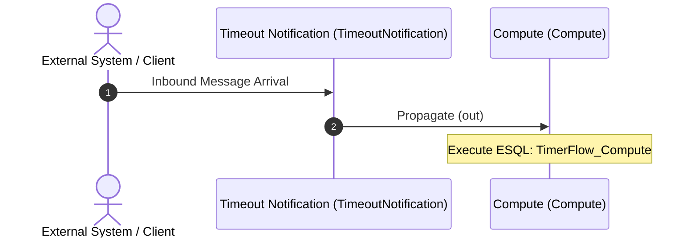

# IBM ACE Message Flow: `TimerFlow`

> **File Location:** `C:\Users\Personal\Downloads\ace-esql-read-env-var-main\ReadEnvVarApplication\TimerFlow.msgflow`  
> **Health Score:** **100/100 (A (Production Ready))**  
> **Total Nodes:** 2 | **Total Wires:** 1

## 1. Flow Architecture Overview


### Flow Topology Diagram


### Execution Sequence Diagram


## 2. Node Specifications & Configurations

| Node Label | Clean Type | Category | Location | Promoted Config | Operational Details |
| :--- | :--- | :--- | :--- | :--- | :--- |
| **Timeout Notification** | `TimeoutNotification` | `Processing Node` | `84,99` | - | **uniqueIdentifier**: `esqlGetenv`<br/>**transactionMode**: `no`<br/>**timeoutInterval**: `100000000` |
| **Compute** | `Compute` | `Compute/Transform` | `327,99` | - | **computeExpression**: `esql://routine/#TimerFlow_Compute.Main` |

### Connection & Routing Matrix

| Source Node | Source Terminal | Target Node | Target Terminal | Path Type |
| :--- | :--- | :--- | :--- | :--- |
| **Timeout Notification** | `out` | **Compute** | `in` | 🟢 Standard Flow |

## 4. Associated ESQL Transformation Logic

### ESQL Module for `Compute`: `TimerFlow_Compute`
> **Defined in:** `TimerFlow_Compute.esql` (Schema: `default`)

```sql
CREATE COMPUTE MODULE TimerFlow_Compute
	CREATE FUNCTION Main() RETURNS BOOLEAN
	BEGIN
        
		LOG EVENT SEVERITY 1 CATALOG 'BIPmsgs' MESSAGE 8099 VALUES('Read env var', 'from server.conf.yaml', envVarUserVariable);
		
		RETURN TRUE;
	END;
END MODULE;
```

## 5. Architectural & Reliability Audit Findings

**Overall Flow Health Grade: A (Production Ready) (100/100)**

✓ No major design antipatterns or unhandled error terminals detected.
